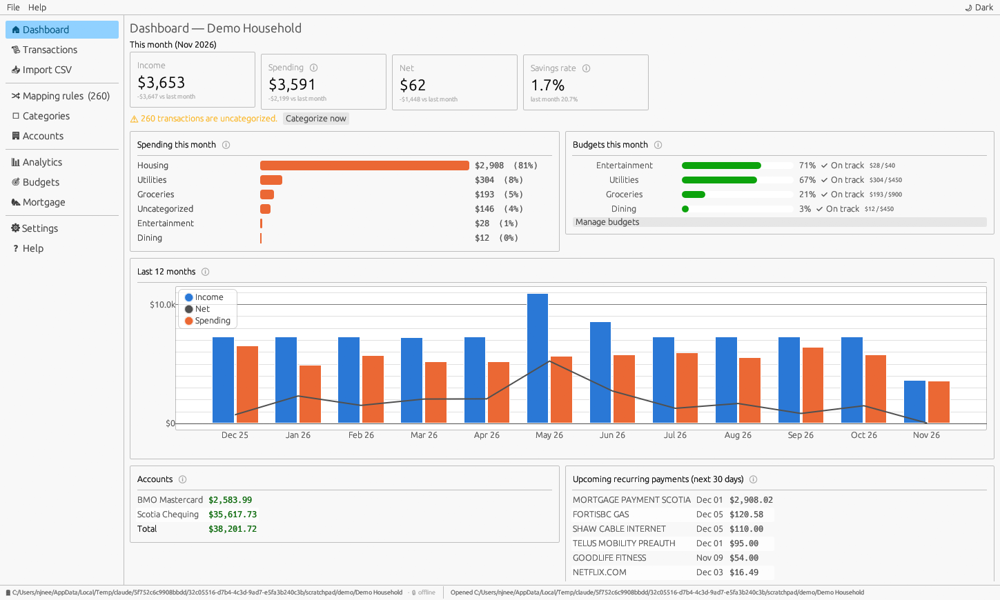
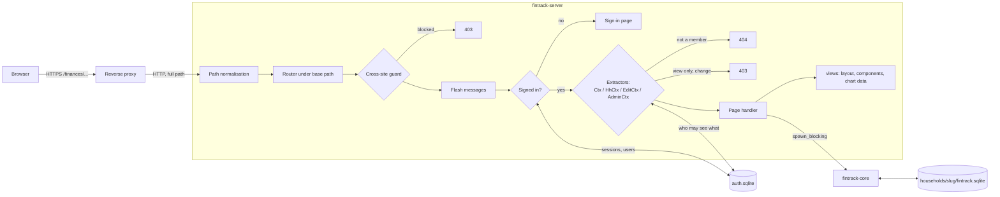
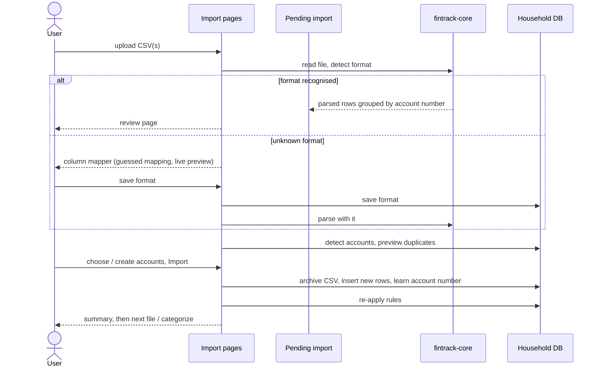

# FinTrack

A household finance tracker you run on your own home server and use from any
browser on your network: `https://miniserver.local/finances`.

Import CSV exports from your bank, have transactions categorized by your own
rules, and see where your money goes by week, month, quarter and year. Track
budgets and a mortgage with prepayments and renewals. Everyone in the house gets
their own sign-in, and an admin decides who can open which household and
whether they can change anything.

FinTrack never talks to the internet. There are no analytics and no CDN
fonts or scripts, and all data stays on your server.



## Contents

1. [Features](#features)
2. [Quick start with Docker](#quick-start-with-docker)
3. [Configuration](#configuration)
4. [Behind a reverse proxy](#behind-a-reverse-proxy)
5. [People, households and permissions](#people-households-and-permissions)
6. [Data, backups and moving from the desktop app](#data-backups-and-moving-from-the-desktop-app)
7. [Security](#security)
8. [Architecture](#architecture)
9. [How the key parts work](#how-the-key-parts-work)
10. [Development](#development)
11. [Known limitations](#known-limitations)
12. [License](#license)

A step-by-step user manual (with screenshots) is in
[docs/FinTrack-User-Manual.pdf](docs/FinTrack-User-Manual.pdf); the same text
is in the app under **Help**.

---

## Features

**Import**
- Upload bank CSV exports. Built-in formats cover Scotiabank and BMO; any
  other bank's format is mapped once in a column mapper with a live preview,
  then recognised automatically.
- The account is detected from the account number in the file, a filename
  hint, or the format the account normally uses.
- Overlapping exports are de-duplicated: re-importing a file adds nothing,
  while two genuinely identical purchases on the same day are both kept.
- Import history with one-click undo. Every imported file is archived on the server.

**Categorize**
- Two-level categories (*Groceries / Save on Foods*, *Income / Mayfair*) of
  kind Expense, Income or Transfer.
- Mapping rules (contains / starts with / equals / regex on description or
  memo, optional amount range, direction and account), applied in priority order.
- An *Unmapped* view that groups uncategorized transactions by payee:
  create a rule from a group, or assign a category once.
- A manual override for any single transaction, which rules never change.

**Understand**
- Dashboard: this month's income, spending, net and savings rate; spending
  by category; budget progress; 12-month cash flow; balances; upcoming bills.
- Analytics with weekly / monthly / quarterly / annual periods, grouped by
  top-level category, subcategory, account or payee: cash flow, stacked
  breakdown with pivot table, trends, top payees, detected subscriptions,
  balances and net worth. Click any group to see its transactions.
- Budgets per category with on-track / close / over status.
- Mortgage tracker with Canadian semi-annual compounding, prepayments
  (date and amount), rate changes at renewal, a what-if extra payment, and
  baseline-vs-prepayment comparison of payoff date and interest.

**Share safely**
- Local accounts: **admins** manage people and households; **users** see only
  the households they're given, either *view only* or *can edit*.
- Several households on one server, each in its own database folder.
- Works on phones, has a light and a dark theme, and everything has tooltips and an in-app guide.

---

## Quick start with Docker

> **Small server?** [DEPLOY.md](DEPLOY.md) explains how to deploy a prebuilt
> image (published to `ghcr.io` by GitHub Actions, or copied over as a file)
> so the server never has to compile anything.

To build on the server itself (Docker with Compose v2):

```sh
git clone <this repository> fintrack && cd fintrack
docker compose up -d --build
docker compose logs fintrack
```

The log shows a **one-time setup link** such as
`/finances/setup?token=…`. Open it through your reverse proxy, e.g.
`https://miniserver.local/finances/setup?token=…`, and create the first admin
account. Then:

1. **Manage households → New household.** Tick *Fill with demo data* if you
   want to explore with 18 months of sample transactions first.
2. **Manage users → Add a user** for each person. FinTrack shows a temporary
   password; they choose their own when they first sign in.
3. **Access tab:** choose *View only* or *Can edit* for each person and household.

Prefer not to use the setup link? Set `FINTRACK_ADMIN_USER` and
`FINTRACK_ADMIN_PASSWORD` for the first start, or run:

```sh
docker compose exec fintrack fintrack-server admin create alice
```

The server has no reverse proxy yet?
[docker/compose.with-caddy.yaml](docker/compose.with-caddy.yaml) runs FinTrack
together with Caddy, which serves HTTPS at `/finances`.

### Commands

| Command | What it does |
|---|---|
| `fintrack-server` (or `serve`) | Run the web server |
| `fintrack-server admin create <name>` | Create an admin with a temporary password |
| `fintrack-server admin reset-password <name>` | Give anyone a new temporary password (e.g. a locked-out admin) |
| `fintrack-server admin list` | List accounts |
| `fintrack-server healthcheck` | Exit 0 if the server answers (used by the container health check) |

Inside the container, prefix with `docker compose exec fintrack`.

---

## Configuration

All settings are environment variables.

| Variable | Default | Meaning |
|---|---|---|
| `FINTRACK_BASE_PATH` | `/` | URL prefix the app lives under, e.g. `/finances`. Any path works. |
| `FINTRACK_BIND` | `0.0.0.0:8080` | Address and port to listen on. |
| `FINTRACK_DATA_DIR` | `/data` | Where accounts and households are stored. |
| `FINTRACK_SECURE_COOKIES` | `true` | Sign-in cookies are sent over HTTPS only. Set `false` only if you really serve plain HTTP. |
| `FINTRACK_SESSION_DAYS` | `30` | How long "Keep me signed in" lasts (renewed on use). Other sessions end after 12 idle hours or when the browser closes. |
| `FINTRACK_MAX_UPLOAD_MB` | `50` | Largest CSV or database upload. |
| `FINTRACK_ADMIN_USER` / `FINTRACK_ADMIN_PASSWORD` | unset | Create this admin on start-up if no admin exists. |
| `TZ` | `UTC` | Time zone for "today", "this month" and so on. |
| `RUST_LOG` | `info` | Log level (`debug` for more detail). |

---

## Behind a reverse proxy

FinTrack serves plain HTTP. Put it behind the reverse proxy you already use for
HTTPS. The proxy must forward the **full path**, *including* the prefix. Don't
strip `/finances`, and set `FINTRACK_BASE_PATH` to the same prefix.

| Proxy | Example |
|---|---|
| Caddy | [docker/Caddyfile.example](docker/Caddyfile.example): `handle /finances* { reverse_proxy fintrack:8080 }` |
| nginx | [docker/nginx.conf.example](docker/nginx.conf.example): `location /finances { proxy_pass http://127.0.0.1:8080; … }` |
| Traefik | [docker/traefik.example.yaml](docker/traefik.example.yaml): `PathPrefix(\`/finances\`)`, no StripPrefix |

The proxy should pass `X-Forwarded-Proto`, `X-Forwarded-Host` and
`X-Forwarded-For` (Caddy and Traefik do this by default). If the sign-in page
warns that it was opened over plain HTTP, the browser isn't using HTTPS or the
proxy isn't sending `X-Forwarded-Proto: https`.

`http://server:8080/` redirects to the base path, and the base path works with
or without a trailing slash.

---

## People, households and permissions

| | Admin | User with *Can edit* | User with *View only* | User without access |
|---|---|---|---|---|
| See dashboard, transactions, analytics, budgets, mortgage | ✔ all households | ✔ | ✔ | the household doesn't appear |
| Import, categorize, edit rules, categories, accounts, budgets, mortgage | ✔ | ✔ | ✘ | ✘ |
| Manage users, households and access | ✔ | ✘ | ✘ | ✘ |

- Admins create, edit, disable and delete accounts and reset passwords. An admin
  can't delete or demote themselves, and the last active admin can't be removed.
- Disabling a user, resetting their password or deleting them signs them out
  everywhere immediately.
- Anyone can change their own name, theme, starting household and password
  under **My account**, and sign out their other devices.

### Guest access

Admins can let visitors look around without an account of their own
(**Manage users → Guest** tab):

- **Allow signing in as a guest** adds a **Continue as guest** button to the
  sign-in page. Off by default.
- For each household, choose what guests can do: no access, view only, or can
  edit. The guest also appears in the **Access** grid.
- The guest account is shared and has no password: it can't be used with the
  normal sign-in form, has no *My account* page, and its sessions end when the
  browser closes.
- Turning guest access off signs out anyone browsing as a guest. Their access
  settings are kept for next time.

---

## Data, backups and moving from the desktop app

```text
/data
├── auth.sqlite            users, households, access, sessions
└── households/
    ├── neeteson-home/     one FinTrack database folder per household
    │   ├── fintrack.sqlite
    │   ├── imports/        a copy of every imported CSV
    │   └── sample-csvs/    (demo households only)
    └── .trash/             deleted households, kept until you remove them
```

- **Backups:** *Manage households → Download backup* writes a consistent
  snapshot of a household's `fintrack.sqlite` while the server runs. To back up
  everything, stop the container and copy the volume.
- **Restore or migrate:** *Manage households → Restore or migrate a database*
  accepts a `fintrack.sqlite` from the FinTrack desktop app or a downloaded
  backup and creates a household from it. Older databases are upgraded automatically.
- **Copying folders in:** a database folder copied into `households/` with a
  lowercase, dash-separated name (e.g. `cottage`) is registered as a household
  the next time the server starts.
- **Deleting** a household moves its folder to `households/.trash/`; nothing is
  destroyed until you delete it there.

---

## Security

- **Passwords** are stored as Argon2id hashes. New and reset accounts get a
  random temporary password that must be changed at first sign-in.
- **Sessions** are random 256-bit tokens in `HttpOnly`, `SameSite=Lax`,
  `Secure` cookies scoped to the base path. The server stores only their
  SHA-256 hash.
- **Throttling:** after 5 wrong passwords for a username or from an address,
  each further attempt has to wait longer (1 s, 2 s, 4 s … up to 5 minutes).
  The error never says whether the username exists.
- **Cross-site protection:** every change must come from FinTrack's own pages,
  checked with the browser's `Sec-Fetch-Site`/`Origin` headers on top of
  `SameSite` cookies.
- **Isolation:** a household is only reachable by its members and admins.
  Anyone else gets *Not found*. View-only members are refused every change
  on the server, not just in the interface.
- **Headers:** a strict Content-Security-Policy (only FinTrack's own scripts),
  `X-Frame-Options: DENY`, `nosniff`, and `Cache-Control: no-store` on pages.
  htmx is configured without `eval` or script execution, and with no page
  snapshots in browser storage, so finance pages aren't kept in `localStorage`.
  Back/forward reloads the page from the server instead.
- **First admin:** the setup page needs a random token printed to the server
  log, so a guest on your network can't claim the admin account first.
- The container runs as an unprivileged user in a distroless image (no shell).

Household databases are not encrypted at rest. Protect the server and its backups.

---

## Architecture

A Cargo workspace with two crates:

| Crate | Role |
|---|---|
| `crates/core` (`fintrack-core`) | Everything about money: CSV reading and format detection, duplicate detection, the rule engine, analytics, budgets, mortgage maths, and SQLite storage for one household. No HTTP, no users. |
| `crates/server` (`fintrack-server`) | The web app: configuration, accounts and sessions, households, permission checks, and the pages (HTML rendered on the server with [maud](https://maud.lambda.xyz)). |

The server renders complete HTML pages and handles plain form posts, and
**[htmx](https://htmx.org)** makes them feel like an app on top of that:

- Every link and form is *boosted*: the next page loads in place without a full
  reload, with a loading bar; actions that return to the same page keep your
  scroll position.
- The transaction and analytics filters refresh their results as you change
  them (search is debounced), and the address bar follows so views stay
  bookmarkable.
- Changing a transaction's category replaces just that table row.
- The column mapper and the rule editor show a live preview as you edit.
- Messages ("Rule saved") appear as toasts.

**Charts** are drawn by [Chart.js](https://www.chartjs.org) from JSON the server
puts on each `<canvas>` (`views/charts`). They have tooltips listing every series
at a point (with totals for stacked bars), legends you can click to hide a
series, and clickable bars and points that open the transactions behind them.
Each chart also has a *Show as table* view of the same data.

Our own scripts are small and readable:
[`app.js`](crates/server/assets/app.js) (tooltips, confirmations, menus,
shortcuts, toasts) and [`charts.js`](crates/server/assets/charts.js). htmx 2.0.4
and Chart.js 4.4.7 are vendored. Everything is compiled into the binary, so
nothing is loaded from a CDN. Without JavaScript every page still works with
ordinary page loads, and charts show as tables.



Importing a file goes through a short-lived *pending import* held in memory
(keyed by an unguessable id, private to one user and household):



### Server modules

```text
crates/server/src
├── main.rs              serve / admin / healthcheck
├── cli.rs               account recovery and health check commands
├── config.rs            FINTRACK_* environment variables
├── state.rs             shared state; short-lived pending items
├── households.rs        household folders: create, demo, restore, delete, backup
├── extract.rs           Ctx, HhCtx, EditCtx, AdminCtx: who may see/change what
├── auth/                passwords, sessions, throttling, cross-site guard, store/
├── flash.rs, error.rs, form.rs, assets.rs, htmx.rs
├── views/               layout, nav, components, forms, format, charts/ (Chart.js data)
└── routes/
    ├── signin.rs, account.rs, home.rs
    ├── admin/           users, households, access matrix
    └── hh/              dashboard, transactions/, import/, categorize/,
                         categories, accounts, analytics/, budgets, mortgage/, help
```

---

## How the key parts work

**Money and signs.** Amounts are `Money(i64)` cents, so there are no
floating-point rounding errors. Positive means money in, negative means money
out, whatever the bank's export does. A format's *flip sign* and *direction
column* options normalise this.

**Format detection.** A format with a header has a *header signature*
(normalised header cells). FinTrack searches the first 25 rows for it, which
also skips bank preambles. A header-less format matches when the first rows have the
expected column count and parse. Header matches outrank shape matches, and
your own formats outrank built-in ones.

**Account detection.** For each group of rows (split by an account-number
column, if any) FinTrack tries, in order: an account with a matching number (exact for long
unmasked numbers, otherwise the last four digits), an account whose filename
hint appears in the file name, then the only account that uses this format. A
signal counts only if it picks exactly one active account.

**Duplicates.** Each transaction has a fingerprint (`date | amount |
normalised description`) and a sequence number among identical fingerprints in
its account. The *k*-th occurrence of a fingerprint in a file is a duplicate if
the account already has *k* of them, so overlapping exports never double-count
and identical purchases on the same day survive. The database enforces
`UNIQUE(account_id, fingerprint, seq)`.

**Categorization.** The category is the manual override if there is one,
otherwise the rule result. Rules are sorted by
`(priority, id)`. Text matching ignores case and extra spaces, and regex rules are
case-insensitive. Rules are re-applied after every rule change and import; only
the automatic category changes.

**Analytics.** Transfer categories are excluded. Spending is −amount for
Expense categories (refunds reduce it); income is the amount. Uncategorized
transactions count by sign. Weeks start on Monday. Budgets scale by period
length (×3 quarterly, ×12 annual).

**Mortgage.** The periodic rate for *n* payments a year is `(1 + j/2)^(2/n) − 1`.
Accelerated bi-weekly and weekly payments are the monthly payment ÷ 2 and ÷ 4.
Prepayments apply after the payment on or after their date. At a rate change
the payment is recalculated over the remaining amortization, so time saved by
earlier prepayments is kept.

---

## Development

Requires Rust 1.88 or newer.

```sh
cargo test --workspace                     # unit + HTTP integration tests
cargo clippy --workspace --all-targets
cargo fmt --all --check                    # 100-column lines (rustfmt.toml)

# Run locally at http://127.0.0.1:8080/finances (plain HTTP, so no secure cookies)
FINTRACK_DATA_DIR=./data FINTRACK_BASE_PATH=/finances \
FINTRACK_BIND=127.0.0.1:8080 FINTRACK_SECURE_COOKIES=false \
cargo run -p fintrack-server

# Generate a demo database folder without the server
cargo run -p fintrack-core --example demo_data -- ./demo
```

The integration tests in `crates/server/tests` drive the whole app (mounted
at `/finances`) through HTTP requests. They cover sign-in and throttling,
cross-site blocking, the permission rules, admin safeguards, the first-run
setup link, every page rendering, and an import round trip with duplicate
detection.

**Adding a page:** create a module under `routes/hh/`, take `HhCtx` to read
and `EditCtx` to change, render with `views::hh_page`, and add it to the side menu in
`views/nav.rs`. **Adding a bank:** add a format to
`crates/core/src/import/builtin.rs`, or map it once in the app.

---

## Known limitations

- Built-in Scotiabank/BMO formats follow commonly seen layouts. Banks change
  their exports occasionally, so use *Edit mapping* when a file isn't read correctly.
- If a bank changes a transaction's description between exports (pending vs
  posted), the two versions aren't recognised as duplicates. Use the *skip rows*
  filter for pending rows.
- Decimal-comma amounts (`1.234,56`) aren't supported.
- Balances come from opening balance plus imported transactions; the bank's
  running balance column is stored but not used to reconcile.
- One server process per data directory (SQLite); the pending-import step
  is lost if the server restarts mid-import.

## License

FinTrack is released under the [MIT License](LICENSE).
