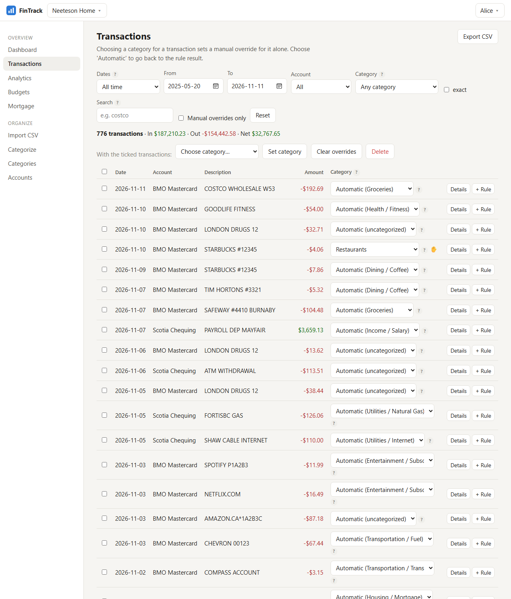
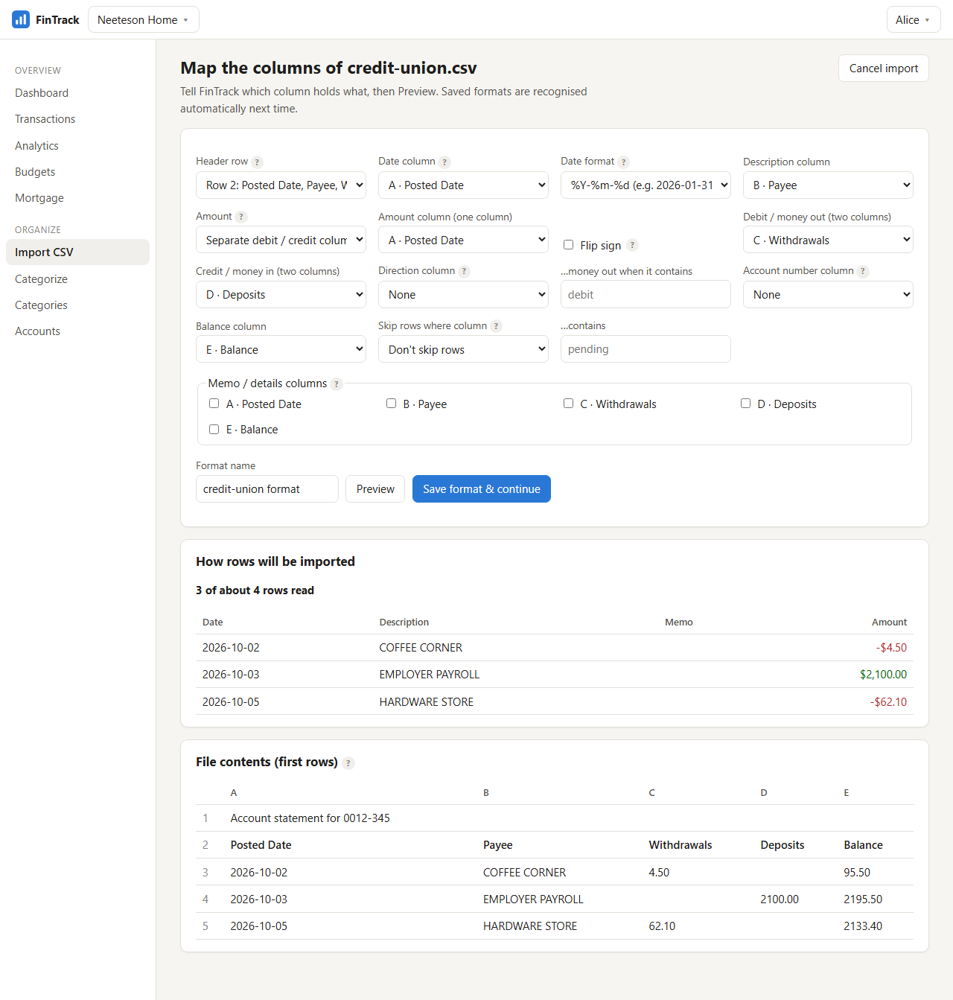
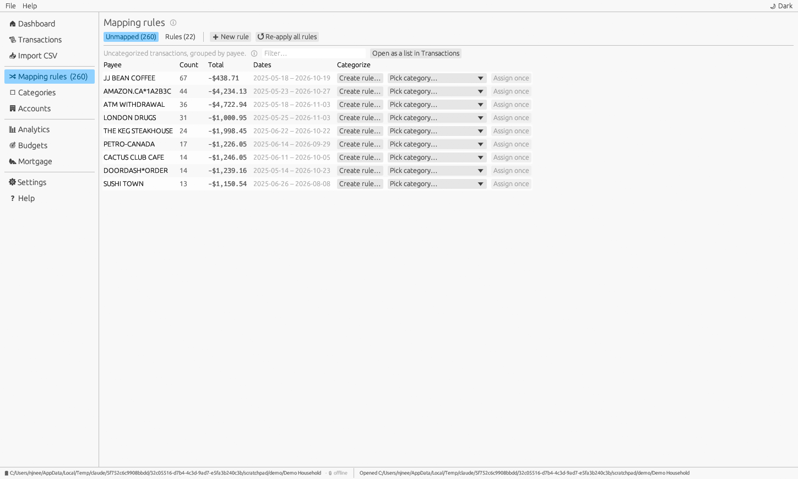
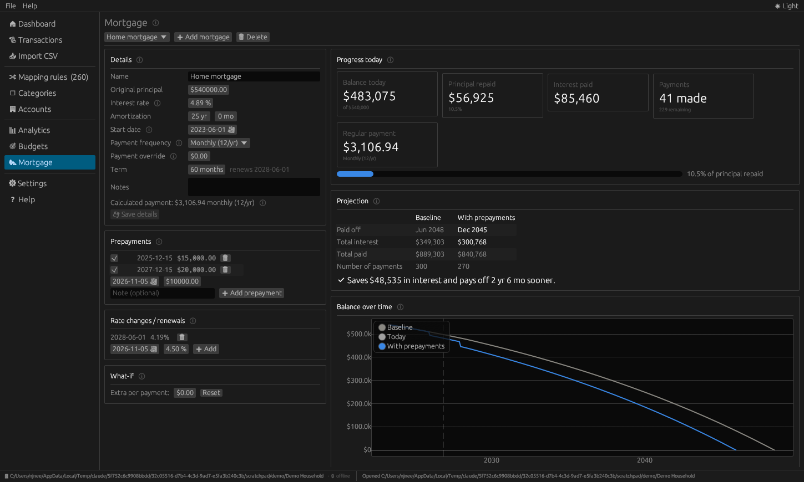
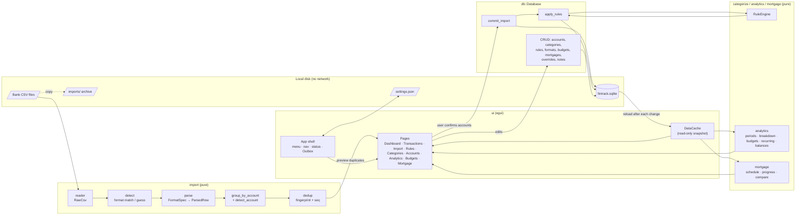
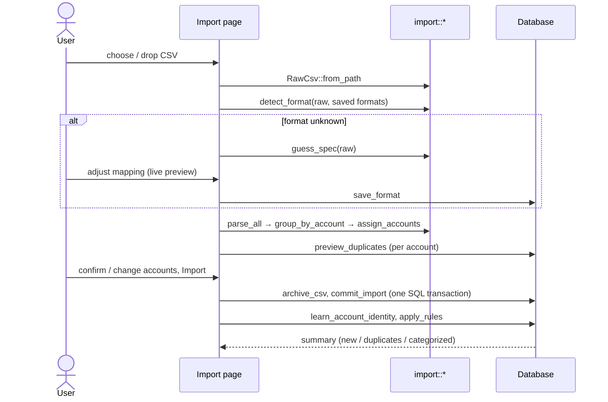

# FinTrack

**A private, fully offline household finance tracker** — import your bank's CSV
exports, categorize transactions with rules, analyse where money comes from and
goes, track budgets, and project your mortgage payoff with prepayments.

FinTrack is a single native desktop application written in Rust
([egui](https://github.com/emilk/egui)). It has **no networking code and no
networking dependencies**: nothing is ever sent to or received from the
internet. All data lives in a folder you choose.


- **User manual (PDF):** [docs/FinTrack-User-Manual.pdf](docs/FinTrack-User-Manual.pdf)
- **In-app help:** the *Help* page, plus a hover tooltip on every **ℹ** marker.

---

## Contents

1. [Features](#features)
2. [Building and running](#building-and-running)
3. [Where data is stored](#where-data-is-stored)
4. [Quick start](#quick-start)
5. [Architecture](#architecture)
6. [Data flow](#data-flow)
7. [How the key parts work](#how-the-key-parts-work)
8. [Project layout](#project-layout)
9. [Testing](#testing)
10. [Extending FinTrack](#extending-fintrack)
11. [Privacy and security](#privacy-and-security)
12. [Known limitations](#known-limitations)
13. [License](#license)

---

## Features

**Databases**
- Create any number of databases; each is a self-contained folder.
- Open existing databases, recent list, and a **default database** opened at startup (Settings).
- One-click backup to a single `.sqlite` file.

**CSV import**
- Drag-and-drop or file picker; multiple files are queued.
- **Automatic format detection** from the header row (or column shape for header-less files).
- Built-in templates for **Scotiabank** (classic bank and credit-card exports, online-banking export) and **BMO** (bank account, credit card).
- **Column mapper** for any other bank: guesses the mapping, shows a live preview, and saves the format so the next file is recognised automatically. Supports single signed amounts, separate debit/credit columns, a sign flip, a "direction" column (e.g. `Debit`/`Credit`), memo columns, account-number and balance columns, and skipping rows such as *Pending*.
- **Automatic account detection** from account numbers in the file (masked numbers like `5191********1234` work), filename hints, or the format an account normally uses. Accounts can be created inline during import.
- **Duplicate handling** for overlapping exports (see [below](#duplicate-detection)).
- Every import is recorded in **import history** with one-click **undo**, and the original CSV is archived in the database folder.

**Categorization**
- **Two-level categories** (`Groceries / Save on Foods`, `Income / Mayfair`) with kinds *Expense*, *Income* and *Transfer*.
- Category manager: add, rename, re-parent, change kind, delete with optional reassignment.
- **Mapping rules**: description/memo *contains / starts with / equals / regex*, optionally limited by direction (money in/out), amount range and account, with priorities.
- **Unmapped view** groups uncategorized transactions by payee for one-click rule creation (or one-off assignment).
- **Manual overrides** per transaction that rules never change (✋ marker), bulk editing, notes.
- Rule editor with a **live preview** of matching transactions, and a rule tester.

**Analytics** (weekly, monthly, quarterly, annual; any date range)
- **Cash flow**: income vs spending per period, net and savings rate.
- **Breakdown**: stacked chart, ranking and pivot table bucketed by **top-level category, subcategory, account or payee**; click any bucket to drill into its transactions.
- **Trends** for any single bucket, **top payees**, **recurring payment detection** (subscriptions and bills with monthly cost), **account balances and net worth** over time.
- Dashboard with this month's headline numbers, budget status, last 12 months and upcoming recurring payments.

**Budgets**
- Monthly budget per category (top-level budgets include their subcategories), viewed per week, month, quarter or year, with colour **and** text status, plus "suggest from my average".

**Mortgage tracker**
- Canadian **semi-annual compounding**, all common payment frequencies including accelerated bi-weekly/weekly.
- Progress to date, full schedule (per year or per payment), balance chart.
- **Prepayments** (date + amount) and **rate changes / renewals**; toggle prepayments on/off and add a "what-if" extra amount per payment to compare against the baseline: payoff date, interest saved and time saved.

**Demo mode**
- **Enter demo mode** on the start screen (or *File ▸ Try the demo*) opens a built-in sample household — 18 months of transactions, rules, budgets and a mortgage — in a temporary folder. A banner marks demo mode; the demo is never added to recent/default databases and is deleted when you exit it or close FinTrack.

**Other**
- Light and dark mode (toggle in the menu bar, or follow the system), Transactions CSV export, command-line options for opening a page or importing files.

| | |
|---|---|
|  |  |
|  |  |

---

## Building and running

Requirements: a recent stable Rust toolchain (edition 2024, Rust ≥ 1.88). Dependencies
are fetched by Cargo at build time; the built application never uses the network.

```sh
cargo run --release              # build and start FinTrack
cargo build --release            # binary at target/release/fintrack(.exe)
```

### Command-line options

```text
fintrack [--demo] [--page <page>] [--import <file.csv>]... [file.csv]...
```

| Option | Meaning |
|---|---|
| `--demo` | Start in demo mode instead of opening the default database. |
| `--page <page>` | Open on a page: `dashboard`, `transactions`, `import`, `categorize`, `categories`, `accounts`, `analytics`, `budgets`, `mortgage`, `settings`, `help`. |
| `--import <file>` / bare file paths | Queue CSV files on the Import page of the default database (works with *Open with…*). |

| Environment variable | Meaning |
|---|---|
| `FINTRACK_SETTINGS` | Path of the settings file to use instead of the per-user default (portable installs, testing). |

### Demo data

The demo is generated by `src/demo.rs` (deterministic, ~18 months ending
today, imported through the real pipeline including an overlapping export to
show duplicate handling). In the app it backs **demo mode**
(`%TEMP%\FinTrack-demo-<pid>`, deleted on exit; folders left by a crash are
cleaned up after 12 hours). To keep a copy on disk:

```sh
cargo run --example demo_data -- <output-folder>
```

This creates `<output-folder>/Demo Household` plus the generated bank CSVs in
`<output-folder>/sample-csvs/` so you can try importing them yourself.

---

## Where data is stored

```text
<your database folder>/            e.g. Documents/Household Finances/
├── fintrack.sqlite                 everything: accounts, transactions, categories, rules,
│                                   CSV formats, budgets, mortgages, import history
└── imports/                        timestamped copy of every imported CSV (optional)
```

Settings (default database, recent list, theme, import options) are a small
JSON file in the per-user config directory — on Windows
`%APPDATA%\FinTrack\config\settings.json`. The Settings page shows the exact path.

---

## Quick start

0. **Just exploring?** Click **Enter demo mode** on the start screen.
1. **Create a database** — *File ▸ New database* (or the start screen): choose a name and a location.
2. **Import** — *Import CSV ▸ Choose CSV files…* or drag files onto the window. Pick or create the account if it isn't detected.
3. **Categorize** — *Mapping rules ▸ Unmapped*: click *Create rule…* next to each payee.
4. **Explore** — Dashboard, Analytics, Budgets, Mortgage.
5. **Make it the default** — *Settings ▸ Startup ▸ Use the current database*.

The [user manual](docs/FinTrack-User-Manual.pdf) walks through every screen.

---

## Architecture

The crate is a library (`fintrack`) plus a thin binary (`src/main.rs`). The
library is split into a **UI-free core** and the **egui front-end**:

| Layer | Modules | Responsibility |
|---|---|---|
| Domain | `model` | Plain data types: `Money` (integer cents), `Transaction`, `Account`, `Category`/`CategoryTree`, `Rule`, `CsvFormat`/`FormatSpec`, `Mortgage`, `Budget`. |
| Import | `import::{reader, detect, parse, dedup, builtin}` | Read CSV → recognise format / guess mapping → parse rows → group by account → detect account → classify duplicates. Pure functions. |
| Categorization | `categorize` | Compiles rules into a `RuleEngine`; first match by priority wins; payee-pattern suggestion. |
| Analytics | `analytics::{period, range, flow, aggregate, summary, balances, recurring, budget}` | Pure aggregations over in-memory transactions. |
| Mortgage | `mortgage::{amortization, …}` | Schedules with semi-annual compounding, prepayments, rate changes; progress and scenario comparison. |
| Storage | `db::*` | `Database` wraps one SQLite connection; one submodule per table adds methods. Schema migrations via `PRAGMA user_version`. |
| Settings | `settings` | JSON settings file. |
| Help | `help` | Every tooltip and help topic in one place, shared by the UI and documentation. |
| UI | `ui::{state, data, widgets, charts, filters, theme, launch, pages::*}` | Application shell, shared widgets and one module per page. |

Design principles:

- **Core is UI-agnostic and tested.** Everything outside `ui` is covered by unit tests and has no egui dependency.
- **One source of truth.** The SQLite database holds all state. The UI keeps a read-only `DataCache` snapshot that is reloaded after every change (`generation` counter lets pages invalidate derived caches).
- **Pages don't mutate each other.** A page receives a `PageCtx` (database, cache, settings, palette, and an `Outbox`). Side effects — reload, navigate, open the rule editor with a draft, show a status message, open a database — are requested through the `Outbox` and applied by the shell after the frame.
- **Small modules, shared building blocks.** Enum plumbing (`str_enum!`), pickers, tiles, cards, charts and the date-range selector are written once and reused.

---

## Data flow



The import flow in detail:



---

## How the key parts work

### Money and sign convention
Amounts are `Money(i64)` cents — no floating-point rounding errors. **Positive =
money in, negative = money out**, regardless of how the bank exports it (the
format's *flip sign* / *direction column* options normalise this).

### Format detection
A saved format with a header has a **header signature** (normalised header
cells). The first 25 rows of a file are searched for that signature, which also
skips bank preambles. Header-less formats match when the first rows have the
expected column count and parse successfully. Header matches outrank shape
matches; user-defined formats outrank built-ins.

### Account detection
For each group of rows (grouped by the account-number column, if any):
1. an account whose number matches (exact for long unmasked numbers, otherwise last 4 digits);
2. an account whose *filename hint* appears in the file name;
3. the only account that normally uses this format.

A signal is used only if it identifies exactly one active account. After
import, FinTrack stores the account number and format it saw on that account.

### Duplicate detection
Each transaction has a **fingerprint** — `date | amount | normalised description`
— and a **sequence number** among identical fingerprints in its account. When
importing, the *k*-th occurrence of a fingerprint in the file is a duplicate if
the account already holds at least *k* transactions with that fingerprint. So
overlapping exports never double-count, while two genuinely identical purchases
on the same day are both kept. The database enforces
`UNIQUE(account_id, fingerprint, seq)`.

### Categorization
`category = manual override ?? rule result`. The engine sorts enabled rules by
`(priority, id)`; text matching is case- and whitespace-insensitive; regex rules
are case-insensitive. Rules are re-applied to every transaction whenever a rule
changes and after each import — only the automatic column is updated, so manual
overrides are never lost.

### Analytics semantics
- *Transfer* categories are excluded from income and spending.
- *Spending* = −amount for Expense categories (refunds reduce spending); *Income* = amount.
- Uncategorized transactions count as spending or income by sign.
- Weeks start on Monday. Budgets scale by period length (×3 quarterly, ×12 annual, ×12/52 weekly).

### Mortgage maths
Periodic rate for *n* payments per year: `(1 + j/2)^(2/n) − 1` (Canadian
semi-annual compounding). Level payment `P·r / (1 − (1+r)^−N)`. Accelerated
bi-weekly/weekly pay the monthly payment ÷ 2 / ÷ 4. Prepayments are applied
after the payment on or after their date and shorten the amortization. At a
rate change the payment is recalculated over the *remaining* amortization (time
the balance would take at the old rate and payment), so time saved by earlier
prepayments is kept. The final payment absorbs cent-rounding residue.

---

## Project layout

```text
src/
├── main.rs                 binary: parse LaunchOptions, start eframe
├── lib.rs                  crate root
├── enum_macro.rs           str_enum! (storage key, label, ALL, parsing)
├── help.rs                 all tooltips and help topics
├── settings.rs             AppSettings (JSON)
├── demo.rs                 built-in demo data generator and temporary DemoWorkspace
├── model/                  money, account, category, rule, format, transaction, mortgage
├── import/                 reader, detect, parse, dedup, builtin, mod (grouping, account detection)
├── categorize/             rule engine, pattern suggestion
├── analytics/              period, range, flow, aggregate, summary, balances, recurring, budget
├── mortgage/               amortization, progress & comparison
├── db/                     schema, seed, sql conversions, one file per table
└── ui/
    ├── mod.rs              app shell (menu, nav, status bar, database lifecycle, Outbox handling)
    ├── state.rs            View, Outbox, PageCtx, AppAction
    ├── data.rs             DataCache
    ├── launch.rs           command-line options
    ├── widgets.rs          pickers, tiles, cards, confirm buttons, help markers
    ├── charts.rs           cash-flow, stacked, line and bar-list charts
    ├── filters.rs          date range selector
    ├── theme.rs            validated colour palette (light/dark) and status colours
    └── pages/              dashboard, transactions, import/{mapping,review}, categorize/{unmapped,rules,editor},
                            categories, accounts, analytics/{cash_flow,breakdown,trends,payees,recurring,balances},
                            budgets, mortgage/{form,projection}, settings, help, start
examples/demo_data.rs       demo database generator
docs/                       user manual (HTML source + PDF) and screenshots
```

---

## Testing

```sh
cargo test                       # unit tests for the core (parsing, detection, dedup, rules,
                                 # analytics, mortgage maths, database layer, settings, CLI)
cargo clippy --all-targets       # lints (clean)
cargo fmt                        # formatting (rustfmt.toml)
```

The database tests run against temporary on-disk databases.

---

## Extending FinTrack

- **A new built-in bank format** — add a `(name, FormatSpec)` entry to `import/builtin.rs` and a detection test in `import/detect.rs`. (Users can also just map it in the app.)
- **A new page** — add a variant to `View` in `ui/state.rs`, a module under `ui/pages/`, a field in `Pages` and a match arm in `Session::show` (`ui/mod.rs`).
- **A new analytic** — write a pure function in `analytics/` with a unit test, then render it from a page.
- **Schema changes** — append a migration to `MIGRATIONS` in `db/schema.rs`; existing databases upgrade automatically on open.
- **Help text** — add tooltips to `help::tips` and topics to `help::TOPICS`; the Help page picks them up.

---

## Privacy and security

- No networking code or networking crates (`cargo tree` contains no HTTP client, socket or async runtime crates). The binary only reads and writes files you choose plus its settings file.
- The SQLite database is **not encrypted**. Store it on an encrypted drive (BitLocker, FileVault, …) if others can access your computer.
- Imported CSVs are archived in `imports/` by default (turn off in Settings).

---

## Known limitations

- Built-in Scotiabank/BMO templates follow commonly seen export layouts; banks change their exports occasionally — use *Edit mapping* if a file isn't read correctly.
- If a bank changes a transaction's description between exports (e.g. pending → posted), the two versions are not recognised as duplicates; use the *skip rows* filter for pending rows or delete the duplicate manually.
- Decimal-comma number formats (`1.234,56`) are not supported.
- Balances are computed from opening balance + imported transactions; the bank's own running balance column is stored but not used for reconciliation.

## License

FinTrack is released under the [MIT License](LICENSE).
